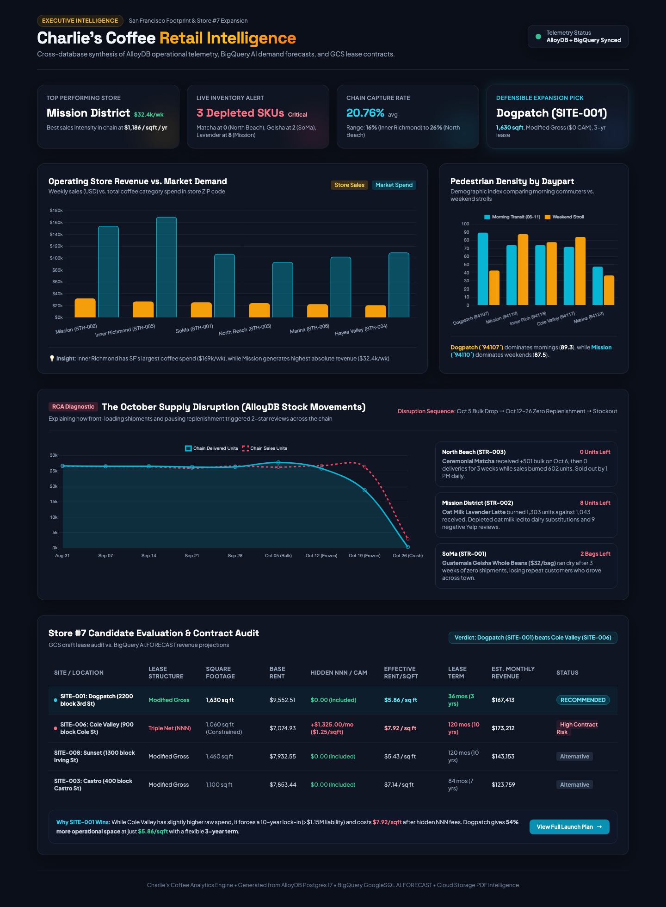

# Retail Site Selection with Google Data Agent Kit

An AI agent picked a site for a coffee chain's seventh store. It worked across
three Google Cloud data sources: operational data in AlloyDB, market and review
analytics in BigQuery, and lease PDFs in Cloud Storage. The agent produced a
site recommendation, a root-cause analysis of a supply-chain failure, a
launch-week operating plan, and a dashboard deployed to Cloud Run.

Built during the **Google Data Cloud Creator Workshop** with
**Data Agent Kit** 1.1.0, driven through the
Antigravity CLI. *Charlie's Coffee* and all of its data are fictional workshop
material.



## The question

Charlie's Coffee runs six stores in San Francisco and has twelve candidate sites
for Store #7. Where should it open, and what has to go right in launch week?

## What the analysis found

| Question | Finding | Source |
| :--- | :--- | :--- |
| Where is demand not being captured? | Inner Richmond has the city's largest coffee spend ($169k/wk) but the chain's lowest capture rate (16%). The chain-wide average is 20.76%. | BigQuery |
| Who walks past each site, and when? | Dogpatch (94107) leads on morning commuter traffic (index 89.3). Mission (94110) leads on weekend traffic (87.5). | BigQuery |
| Why did reviews drop in October? | Shipments were front-loaded on Oct 5, then three weeks passed with no replenishment. Matcha, oat milk and Geisha beans ran out, which showed up as 2-star reviews. | AlloyDB stock movements + BigQuery `AI.GENERATE` on reviews |
| Which site wins? | **Dogpatch (SITE-001).** Cole Valley has slightly higher forecast revenue, but its lease is triple-net (+$1,325/mo hidden CAM) with a 10-year lock-in (more than $1.15M of liability). Dogpatch is modified-gross at $5.86/sqft on a 3-year term, with 54% more floor space. | GCS lease PDFs + BigQuery `AI.FORECAST` |
| What does launch week need? | Split deliveries (60% Monday, 40% Thursday), dedicated oat-milk and retail-bean safety stock, and reorder triggers set to 48 hours of peak sales, plus local partners found through Maps grounding. | All three, plus Maps and weather |

The full plan is in [deploy-dashboard/launch_week_plan.md](deploy-dashboard/launch_week_plan.md).

## How it was built

```
AlloyDB (Postgres 17)        BigQuery                    Cloud Storage
stores, products,            sales, market demand,       12 broker lease
inventory, stock ledger      demographics, reviews       PDFs
        │                           │                          │
        └────────── Data Agent Kit MCP tools (Antigravity agent) ┘
                                    │
             analysis → recommendation → launch plan → dashboard
                                    │
                     nginx container on Cloud Run
```

- **Cross-source reasoning.** The agent joined live AlloyDB inventory data to
  BigQuery demand data, then checked the shortlisted sites against the actual
  lease terms in the PDFs.
- **In-warehouse AI.** `AI.FORECAST` produced the revenue projections, and
  `AI.GENERATE` classified customer reviews to connect stockouts to complaints.
- **Grounding.** Google Maps grounding and live weather data informed the
  launch partners and the plans for weather on opening days.
- **Deployment.** The dashboard is a static single page, served by nginx on
  Cloud Run (`gcloud run deploy charlies-dashboard`). It ran in a temporary lab
  project that has since been torn down. To view it now, open
  [dashboard.html](dashboard.html) in a browser.

## Repository layout

| Path | Contents |
| :--- | :--- |
| [dashboard.html](dashboard.html) | The executive dashboard (Tailwind + Chart.js) |
| [deploy-dashboard/](deploy-dashboard/) | Dockerfile, nginx config and launch plan, as deployed to Cloud Run |
| [project_archive/data_exports/](project_archive/data_exports/) | The source data the agent queried: AlloyDB and BigQuery tables as JSON, plus the lease PDFs |
| [project_archive/session_logs/](project_archive/session_logs/) | Step-by-step record of the agent session: prompts, tool calls and answers |
| [WORKSHOP_NOTES.md](WORKSHOP_NOTES.md) | The original workshop guide: setup, lab prompts, teardown |
| `bin/`, `config/`, `scripts/` | Workshop tooling for setup, health checks and agent launchers |

## Run it locally

```bash
# View the dashboard
open dashboard.html

# Or serve it the way Cloud Run did
docker build -t charlies-dashboard deploy-dashboard
docker run -p 8080:8080 charlies-dashboard   # http://localhost:8080
```

To reproduce the full analysis against live Google Cloud resources, follow
[WORKSHOP_NOTES.md](WORKSHOP_NOTES.md).

## Credits

The workshop materials, scenario, seed data and tooling are by
[Jeff Nelson](https://github.com/jeffonelson/data-cloud-creator-workshop).
The commit history up to "Pin Data Agent Kit to 1.1.0" is his. The analysis,
dashboard, launch plan and deployment are my work from the workshop session.
